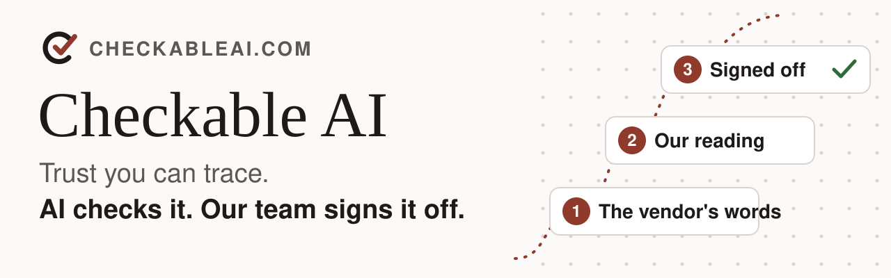

  <picture>
    <source media="(prefers-color-scheme: dark)" srcset="img/hero-dark.svg">
    
  </picture>

  
  
  

  
  
  
  

Every AI vendor says its platform is secure, and each one answers in its own words across dozens of pages. The laws and frameworks that apply to you sit across dozens more. Checkable AI reads both, shows you the evidence, and lets you decide what needs attention.

> [!NOTE]
> Every finding is checked by AI and confirmed by our team before it is published.

## What you get

- **Know what your AI tools promise.** The AI Stack Check shows what each vendor documents against 46 security controls, in the vendor's own words. On 7 Nov 2026 our team confirmed that OpenAI Codex cloud environments keep the real secret out of the program.
- **Know what the rules require.** The AU Frameworks Check finds which of 150 Australian laws and frameworks may reach your business, then gives an indicative assessment and a 180 day plan. EU and US versions are there too.
- **See changes as they land.** The knowledge feed watches 488 AI platforms every day. When a vendor changes a default, a setting or a term, it reaches you as a pull request, a ticket or a chat alert, with the fix ready for a person on your team to approve.

> [!TIP]
> **Start with the AI Stack Check.** It takes about two minutes, needs no account and your answers stay on your device.

## Free checks

| Check | What it shows you | Time |
|---|---|---|
| [AI Stack Check](https://www.checkableai.com/stack-check/) | What each AI vendor documents against 46 security controls, with a score out of 100 | About 2 minutes |
| [AU Frameworks Check](https://www.checkableai.com/readiness-check/) | Which Australian laws and frameworks may reach your business, an indicative assessment and a 180 day plan | About 15 minutes |
| [EU Frameworks Check](https://www.checkableai.com/readiness-check/eu/) and [US Frameworks Check](https://www.checkableai.com/readiness-check/us/) | The same check for EU or US rules | About 15 minutes each |

## Open samples on GitHub

| Repository | What it is |
|---|---|
| [knowledge-base-preview](https://github.com/checkable-ai/knowledge-base-preview) | What 116 AI platforms document, checked against the same 46 security controls, with one plain page per answer. Free to read, copy and build on. |
| [ci-demo](https://github.com/checkable-ai/ci-demo) | Catches AI vendor changes before your code ships, with nightly vendor change pull requests, a named sign-off gate, a deploy gate and a Kubernetes check. |

> [!IMPORTANT]
> For your own AI setup, ask for an assessment or a package and we'll come back to you with scope and timing. **[Make an enquiry](https://www.checkableai.com/enquire/)**.

<strong>How a finding works</strong>: the vendor's words, our reading, then a person signs it off

1. **The vendor's words.** We quote the vendor's own documentation, with the source and the date we checked it.
2. **Our reading.** We say plainly what the words mean for you and what still needs its own check.
3. **Signed off.** AI does the checking and our team confirms each finding before it is published.

[Read a finding](https://www.checkableai.com/evidence/) or see [how we check](https://www.checkableai.com/trust/).

<strong>Where the knowledge feed lands</strong>: your pipeline, your service desk and your team chat

A pull request in your pipeline (GitHub Actions, GitLab, Terraform, Argo CD), a ticket in your IT service desk (ServiceNow, Jira, Freshservice and others) or an alert in your team chat (Microsoft Teams, Slack, email and others). [See the knowledge feed](https://www.checkableai.com/developers/).

  <a href="https://www.checkableai.com/"><strong>checkableai.com</strong></a>
  &nbsp;&middot;&nbsp;
  <a href="https://www.checkableai.com/enquire/"><strong>Make an enquiry</strong></a>

  Copyright (c) 2026 M. Walker. Open samples are under the MIT licence, see each repository.

